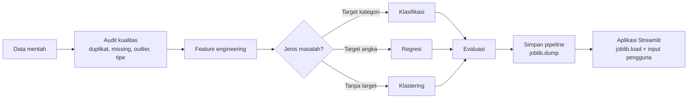
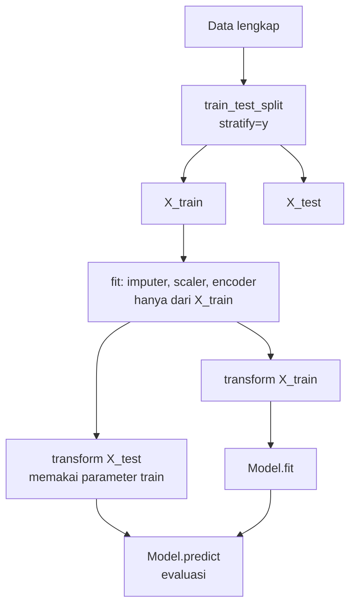
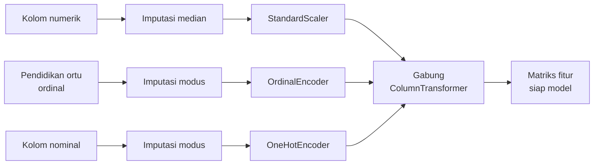
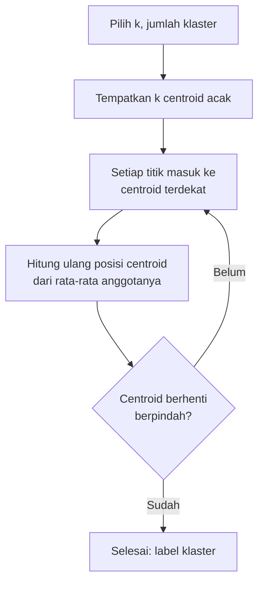
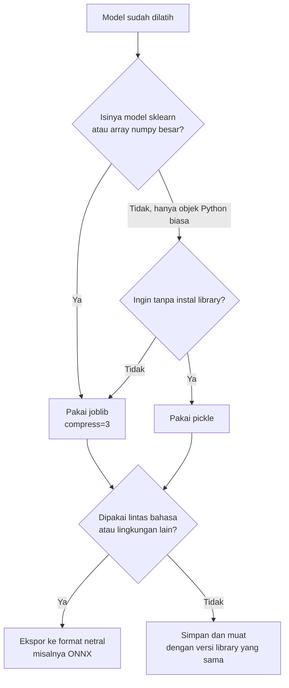
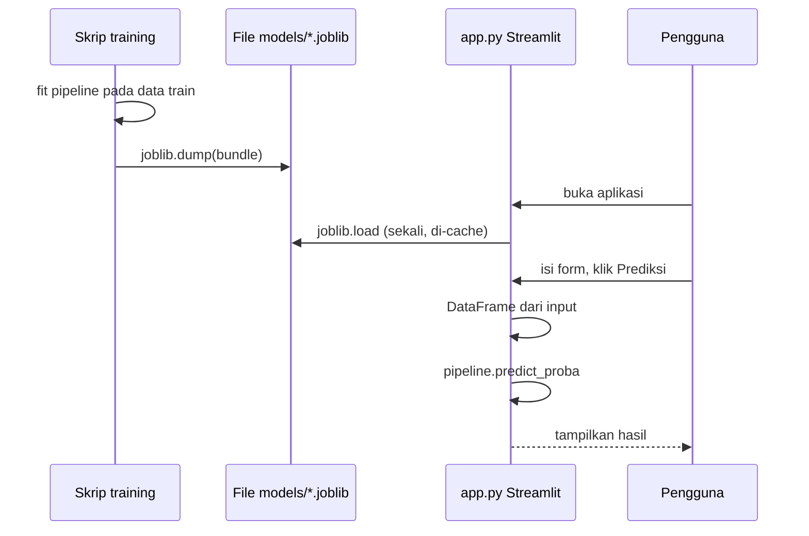
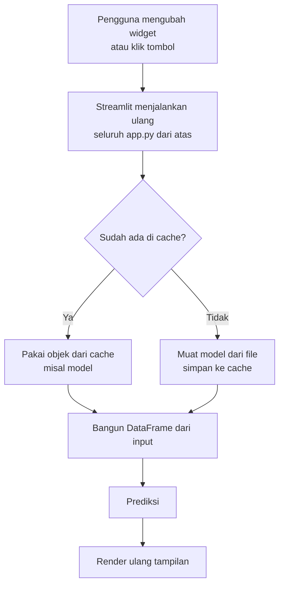
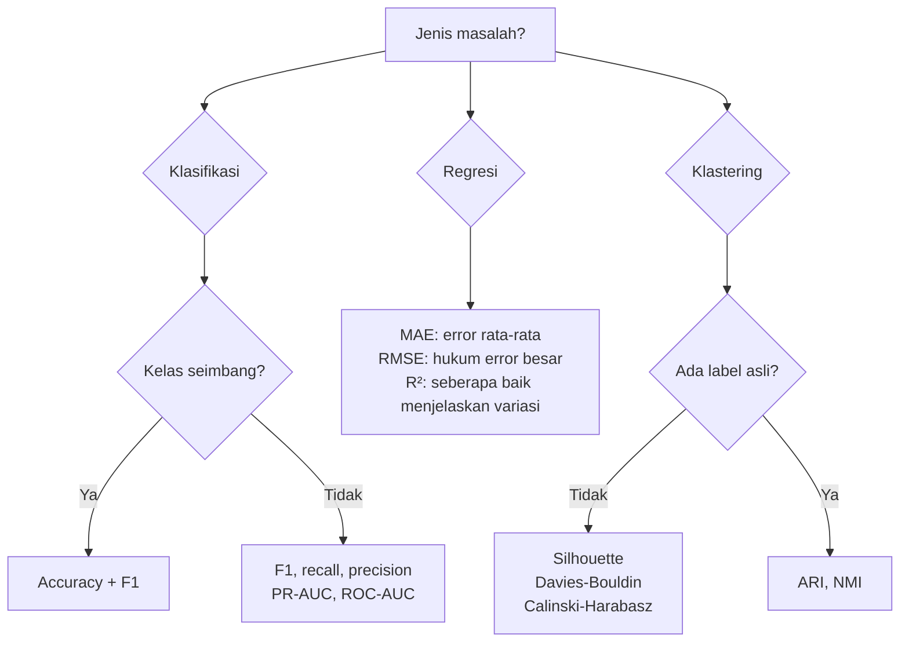

# Materi: Feature Engineering, Machine Learning, dan Deploy dengan Streamlit

Materi ini disusun dari notebook **Machine Learning Klasifikasi** (dataset `case9_student_performance.csv`, 800 siswa) dan dikembangkan ke **regresi** dan **klastering** dengan dataset real lain. Di bagian akhir, model disimpan dengan **joblib** lalu digunakan di aplikasi **Streamlit**.

## Daftar Isi

1. [Peta alur kerja](#1-peta-alur-kerja)
2. [Feature engineering sebelum machine learning](#2-feature-engineering-sebelum-machine-learning)
3. [Klasifikasi](#3-klasifikasi)
4. [Regresi](#4-regresi)
5. [Klastering](#5-klastering)
6. [Menyimpan dan memuat model dengan joblib](#6-menyimpan-dan-memuat-model-dengan-joblib)
7. [Aplikasi web dengan Streamlit](#7-aplikasi-web-dengan-streamlit)
8. [Metrik evaluasi untuk setiap jenis machine learning](#8-metrik-evaluasi-untuk-setiap-jenis-machine-learning)

---

## 1. Peta alur kerja

Setiap proyek machine learning, apa pun jenis masalahnya, mengikuti alur yang sama. Yang berbeda hanya algoritma dan metriknya.



Tiga jenis masalah yang dibahas:

| Jenis | Target (y) | Contoh pertanyaan | Algoritma di materi ini | Metrik utama |
| --- | --- | --- | --- | --- |
| Klasifikasi | Kategori | Apakah siswa lulus? | KNN, Logistic Regression | Precision, recall, F1 |
| Regresi | Angka kontinu | Berapa harga rumah? | Linear Regression, Random Forest | MAE, RMSE, R² |
| Klastering | Tidak ada | Kelompok pelanggan mana yang mirip? | K-Means | Inertia, silhouette |

**Supervised** berarti ada target `y` yang dipelajari (klasifikasi dan regresi). **Unsupervised** berarti tidak ada target, model mencari pola sendiri (klastering).

---

## 2. Feature engineering sebelum machine learning

### 2.1 Apa itu feature engineering

Feature engineering adalah proses menyiapkan dan mengubah data mentah menjadi **fitur** (kolom masukan model) yang bersih, konsisten, dan bermakna. Model hanya sebaik data yang diberikan, sehingga tahap ini sering memakan porsi waktu terbesar dalam proyek nyata.

### 2.2 Audit data

Urutan pemeriksaan di bawah mengikuti urutan dalam notebook: **duplikat → missing value → outlier → tipe data**, lalu fitur turunan.

| Langkah | Pertanyaan yang dijawab | Contoh dari notebook |
| --- | --- | --- |
| Duplikat | Apakah satu entitas muncul lebih dari sekali? | 0 duplikat, dicek dengan `student_id` |
| Missing value | Berapa sel kosong, dan di kolom mana? | 511 sel kosong (3,36%) tersebar di 17 kolom |
| Nilai tidak masuk akal | Apakah ada nilai yang mustahil secara domain? | 5 nilai mapel di bawah 10 (0, 1, 1, 1, 6) pada skala 0–100 |
| Outlier | Apakah nilai ekstrem itu sah atau galat input? | Dicek dengan pagar IQR per grup |
| Tipe data | Apakah angka tersimpan sebagai teks, atau sebaliknya? | `usia` diubah ke integer nullable, kolom nominal ke `category` |
| Fitur turunan | Apakah ada kolom yang dihitung dari kolom lain? | `nilai_rata_rata` = rata-rata 5 mapel |

Contoh kode audit dasar:

```python
import pandas as pd

df = pd.read_csv("data/case9_student_performance.csv")

print("Duplikat baris penuh :", df.duplicated().sum())
print("Duplikat per ID      :", df.duplicated(subset=["student_id"]).sum())

miss = df.isnull().sum()
print(miss[miss > 0].sort_values(ascending=False))

# Nilai di luar domain yang wajar
print("Usia di luar 10-20   :", ((df["usia"] < 10) | (df["usia"] > 20)).sum())  # NaN tidak ikut terhitung
```

### 2.3 Missing value

Ada beberapa cara menangani missing value:

- **Buang baris**: aman hanya jika jumlahnya sangat kecil.
- **Isi dengan statistik**: median untuk numerik (tahan outlier), modus untuk kategorik.
- **Jadikan kategori tersendiri** (misalnya `"Tidak diketahui"`), berguna jika ketiadaan data itu sendiri informatif.
- **Model-based imputation**: misalnya `IterativeImputer`, untuk kasus yang lebih kompleks.

Aturan penting: **nilai pengisi harus dihitung dari data train saja.** Penjelasannya ada di bagian 2.4.

### 2.4 Data leakage: jebakan paling sering

*Data leakage* terjadi ketika informasi dari data uji "bocor" ke proses pelatihan. Akibatnya skor model terlihat bagus, tetapi gagal di data baru.

```python
# SALAH: median dihitung dari seluruh data, lalu baru di-split
df["nilai_ipa"] = df["nilai_ipa"].fillna(df["nilai_ipa"].median())
X_train, X_test, y_train, y_test = train_test_split(X, y, test_size=0.2)

# BENAR: split dulu, lalu pipeline yang belajar (fit) hanya dari data train
X_train, X_test, y_train, y_test = train_test_split(X, y, test_size=0.2, random_state=42)
pipeline.fit(X_train, y_train)   # imputer, scaler, encoder dihitung dari train saja
pipeline.predict(X_test)          # data test hanya ditransformasi
```



### 2.5 Fitur redundan dan kolinearitas

Jika satu kolom adalah hasil hitungan dari kolom lain, memasukkan keduanya ke model tidak menambah informasi, dan bisa membuat model tidak stabil. Di notebook, `nilai_rata_rata` adalah rata-rata dari lima nilai mapel (selisih maksimum 0,0), sehingga kolom itu **dikeluarkan dari fitur** meskipun tetap disimpan di data bersih.

```python
mapel = ["nilai_matematika", "nilai_bahasa_indonesia", "nilai_ipa",
         "nilai_ips", "nilai_bahasa_inggris"]
selisih = (df[mapel].mean(axis=1) - df["nilai_rata_rata"]).abs()
print("Selisih maksimum:", selisih.max())   # jika ~0, kolom ini turunan
```

### 2.6 Encoding: mengubah kategori menjadi angka

| Jenis kategori | Contoh | Teknik | Keterangan |
| --- | --- | --- | --- |
| Nominal (tanpa urutan) | `jenis_sekolah`: Negeri / Swasta | `OneHotEncoder(drop="first")` | `drop="first"` menghindari jebakan dummy pada model linear |
| Ordinal (ada urutan) | `pendidikan_orang_tua`: SD < SMP < SMA < S1 < S2 | `OrdinalEncoder(categories=[urutan])` | Urutan harus eksplisit, jangan diserahkan ke alfabet |

Di notebook, `pendidikan_orang_tua` dimasukkan sebagai one-hot. Itu tidak salah, tetapi kehilangan informasi bahwa S2 "lebih tinggi" dari SD. Versi materi ini memakai ordinal.

### 2.7 Scaling: menyamakan skala fitur

Model yang menghitung **jarak** (KNN, K-Means, SVM) atau yang dioptimasi dengan **gradien** (Logistic Regression, Linear Regression, neural network) sensitif terhadap skala. Fitur dengan rentang besar (misalnya pendapatan dalam jutaan) akan mendominasi fitur kecil (misalnya usia).

- `StandardScaler`: mengubah ke rata-rata 0 dan standar deviasi 1. Cocok untuk sebagian besar kasus.
- `MinMaxScaler`: mengubah ke rentang 0–1. Cocok jika distribusi tidak mendekati normal.
- **Random Forest dan pohon keputusan tidak memerlukan scaling**, karena pembagian pohon hanya membandingkan urutan nilai.

### 2.8 Transformasi dan binning

- **Transformasi log** (`np.log1p`) untuk data yang sangat miring (skewed), misalnya pengeluaran atau jumlah penduduk. Dipakai di bagian regresi dan klastering.
- **Binning** (`pd.cut`) mengelompokkan angka menjadi kategori. Notebook memakai ini untuk jam belajar (`<10`, `10–20`, `20–30`, `>30` jam). Binning membuang detail, jadi gunakan jika ada alasan bisnis yang jelas.

```python
import numpy as np

# Transformasi log untuk data miring (contoh pada kolom jam belajar)
df["log_jam_belajar"] = np.log1p(df["jam_belajar_per_minggu"])

# Binning dengan batas yang bermakna
df["kelompok_jam"] = pd.cut(
    df["jam_belajar_per_minggu"],
    bins=[0, 10, 20, 30, np.inf],
    labels=["<10 jam", "10-20 jam", "20-30 jam", ">30 jam"],
)
```

### 2.9 Analisis cepat sebelum modeling

Sebelum melatih model, lakukan analisis deskriptif agar tahu fitur mana yang relevan. Notebook memakai `groupby`, `pivot_table`, dan `crosstab`. Dari hasil analisis itu didapat beberapa temuan:

- Siswa yang belajar **kurang dari 10 jam/minggu** hanya **3,4%** yang lulus, sedangkan yang belajar **lebih dari 30 jam/minggu** mencapai **99,6%**. Korelasi jam belajar dengan kelulusan **0,776**.
- Kehadiran di bawah 60% hanya **46,4%** yang lulus, sedangkan kehadiran 90% ke atas mencapai **77,5%**. Namun korelasinya hanya **0,217**, jauh di bawah jam belajar.
- Siswa tanpa akses internet dan tanpa les privat hanya **51,5%** yang lulus. Dengan keduanya, angkanya naik ke **68,2%**.

Kode dasar untuk analisis serupa:

```python
# Persentase kelulusan per kelompok
df["lulus"] = (df["status_kelulusan"] == "Lulus").astype(int)
print(df.groupby("kelompok_jam", observed=True)["lulus"].mean().mul(100).round(1))

# Pivot: baris = jenis sekolah, kolom = pendidikan orang tua
pivot = pd.pivot_table(df, values="lulus", index="jenis_sekolah",
                       columns="pendidikan_orang_tua", aggfunc="mean", observed=True)
print(pivot.mul(100).round(1))
```

### 2.10 Menggabungkan semuanya dengan `ColumnTransformer`

Daripada mengolah tiap kolom secara manual, semua langkah dibungkus dalam satu objek yang bisa di-`fit` dan di-`transform` dengan aman:

```python
from sklearn.compose import ColumnTransformer
from sklearn.impute import SimpleImputer
from sklearn.pipeline import Pipeline
from sklearn.preprocessing import OneHotEncoder, OrdinalEncoder, StandardScaler

URUTAN_PENDIDIKAN = ["SD", "SMP", "SMA", "S1", "S2"]

FITUR_NUM = ["usia", "jam_belajar_per_minggu", "persentase_kehadiran", "waktu_tempuh_menit",
             "nilai_matematika", "nilai_bahasa_indonesia", "nilai_ipa", "nilai_ips",
             "nilai_bahasa_inggris"]
FITUR_ORD = ["pendidikan_orang_tua"]
FITUR_NOM = ["jenis_kelamin", "jenis_sekolah", "pekerjaan_orang_tua",
             "ikut_ekskul", "akses_internet", "les_privat"]

preprocess = ColumnTransformer([
    ("num", Pipeline([
        ("imputer", SimpleImputer(strategy="median")),   # median tahan outlier
        ("scaler", StandardScaler()),
    ]), FITUR_NUM),
    ("ord", Pipeline([
        ("imputer", SimpleImputer(strategy="most_frequent")),
        ("enc", OrdinalEncoder(categories=[URUTAN_PENDIDIKAN],
                               handle_unknown="use_encoded_value", unknown_value=-1)),
    ]), FITUR_ORD),
    ("nom", Pipeline([
        ("imputer", SimpleImputer(strategy="most_frequent")),
        ("ohe", OneHotEncoder(drop="first", handle_unknown="ignore", sparse_output=False)),
    ]), FITUR_NOM),
])
```



---

## 3. Klasifikasi

### 3.1 Konsep

**Klasifikasi** memprediksi **label kategori** dari fitur. Jika hanya ada dua kelas, disebut *binary classification* (contoh: Lulus / Tidak Lulus). Jika lebih dari dua, disebut *multiclass* (contoh: Tidak lulus / Lulus / Lulus dengan nilai terbaik seperti di contoh notebook).

Alur kerja klasifikasi:

1. Siapkan `X` (fitur) dan `y` (label).
2. Split data menjadi train dan test (dengan `stratify=y` jika kelas tidak seimbang).
3. `fit` pipeline pada data train.
4. `predict` pada data test.
5. Evaluasi dengan metrik yang sesuai.

### 3.2 Tiga algoritma dari notebook

**K-Nearest Neighbors (KNN)** memprediksi kelas dari mayoritas `k` tetangga terdekat. Tidak ada "pelatihan" dalam arti parameter, model hanya menyimpan data. Karena itu scaling sangat penting.

**Logistic Regression** memodelkan probabilitas kelas lewat fungsi sigmoid. Meski namanya "regresi", ini algoritma klasifikasi.

**Naive Bayes** menghitung probabilitas setiap kelas dengan asumsi fitur saling independen. Varian `CategoricalNB` untuk fitur kategorik berupa bilangan bulat, dan `GaussianNB` untuk fitur kontinu.

Contoh dari notebook dengan data mainan (2 fitur, 3 kelas):

```python
from sklearn.neighbors import KNeighborsClassifier
from sklearn.linear_model import LogisticRegression
from sklearn.naive_bayes import CategoricalNB

X = [[60, 50], [30, 70], [70, 80], [80, 75], [80, 90], [87, 98], [30, 90]]
y = [0, 0, 1, 1, 2, 2, 1]   # 0 = Tidak lulus, 1 = Lulus, 2 = Lulus dengan nilai terbaik

knn = KNeighborsClassifier(n_neighbors=3).fit(X, y)
print(knn.predict([[60, 90]]))        # -> [1]

clf = LogisticRegression(random_state=0).fit(X, y)
print(clf.predict([[4, 7]]))          # -> [0]

cnb = CategoricalNB().fit(X, y)
print(cnb.predict([[2, 2]]))          # -> [1]
```


### 3.3 Metrik evaluasi

Pada data tidak seimbang seperti di notebook (61,6% Lulus vs 38,4% Tidak Lulus), **accuracy saja menyesatkan**. Model yang selalu menebak "Lulus" sudah mendapat 61,6% accuracy tanpa belajar apa pun.

| Metrik | Rumus | Pertanyaan yang dijawab |
| --- | --- | --- |
| Accuracy | (TP + TN) / Total | Dari semua prediksi, berapa yang benar? |
| Precision | TP / (TP + FP) | Dari yang diprediksi Lulus, berapa yang benar-benar Lulus? |
| Recall | TP / (TP + FN) | Dari yang benar-benar Lulus, berapa yang berhasil terdeteksi? |
| F1-score | 2 × P × R / (P + R) | Keseimbangan precision dan recall |

Keterangan: TP = benar positif, TN = benar negatif, FP = salah positif, FN = salah negatif.

Confusion matrix menampilkan keempat angka itu sekaligus:

```python
from sklearn.metrics import confusion_matrix, classification_report

print(confusion_matrix(y_test, y_pred))
print(classification_report(y_test, y_pred, target_names=["Tidak Lulus", "Lulus"]))
```

### 3.4 Model klasifikasi siswa dengan pipeline

Gabungkan kode dari bagian 2.10 (definisi `preprocess`) dan bagian 3.4 ini ke dalam satu skrip, `latih_klasifikasi.py`. Kode berikut menggantikan pendekatan manual di bagian "Model Student" notebook. Semua langkah preprocessing ada di dalam pipeline, dan pemilihan model dilakukan dengan cross-validation di data train, bukan di data test.

```python
import numpy as np
import pandas as pd
from pathlib import Path
from sklearn.model_selection import cross_val_score, train_test_split
from sklearn.metrics import classification_report
from sklearn.pipeline import Pipeline
from sklearn.neighbors import KNeighborsClassifier
from sklearn.linear_model import LogisticRegression

RANDOM_STATE = 42
KOL_NILAI = ["nilai_matematika", "nilai_bahasa_indonesia", "nilai_ipa",
             "nilai_ips", "nilai_bahasa_inggris"]

# --- 1. Muat dan bersihkan minimal (sesuai notebook) ---
df = pd.read_csv("data/case9_student_performance.csv")
df = df.drop_duplicates(subset=["student_id"]).reset_index(drop=True)
df[KOL_NILAI] = df[KOL_NILAI].mask(df[KOL_NILAI] < 10)   # nilai < 10 dianggap sentinel
for c in df.select_dtypes(exclude="number").columns:
    df[c] = df[c].str.strip()

# --- 2. Fitur dan target ---
KOL_KAT = FITUR_ORD + FITUR_NOM
X = df[FITUR_NUM + KOL_KAT].copy()
# Kolom kategorik: ubah NA menjadi np.nan (object) agar SimpleImputer aman
X[KOL_KAT] = X[KOL_KAT].astype(object).where(X[KOL_KAT].notna(), np.nan)
y = (df["status_kelulusan"] == "Lulus").astype(int)

# --- 3. Split SEBELUM preprocessing (anti-leakage) ---
X_train, X_test, y_train, y_test = train_test_split(
    X, y, test_size=0.2, random_state=RANDOM_STATE, stratify=y)

# --- 4. Bandingkan model dengan cross-validation di data TRAIN ---
kandidat = {
    "KNN (k=5)": KNeighborsClassifier(n_neighbors=5),
    "Logistic Regression": LogisticRegression(max_iter=2000, class_weight="balanced"),
}
for nama, clf in kandidat.items():
    pipe = Pipeline([("prep", preprocess), ("clf", clf)])
    skor = cross_val_score(pipe, X_train, y_train, cv=5, scoring="f1")
    print(f"{nama:22} F1 CV = {skor.mean():.3f} (± {skor.std():.3f})")
```

Setelah model dipilih, latih pada seluruh data train, lalu evaluasi **satu kali** di data test:

```python
model = Pipeline([
    ("prep", preprocess),
    ("clf", LogisticRegression(max_iter=2000, class_weight="balanced")),
])
model.fit(X_train, y_train)
y_pred = model.predict(X_test)
print(classification_report(y_test, y_pred, target_names=["Tidak Lulus", "Lulus"]))
```

### 3.5 Threshold: mengatur batas keputusan

Secara default, `predict` memakai threshold 0,5 pada probabilitas. Pada data tidak seimbang atau ketika kesalahan jenis tertentu lebih mahal, threshold bisa diatur ulang. Ini pola yang juga dipakai di repo Fraud Detection (disimpan sebagai `optimal_threshold`).

```python
from sklearn.metrics import f1_score

proba = model.predict_proba(X_test)[:, 1]
kandidat_t = np.arange(0.2, 0.81, 0.01)
skor_f1 = [f1_score(y_test, proba >= t) for t in kandidat_t]
threshold_terbaik = kandidat_t[int(np.argmax(skor_f1))]
print("Threshold terbaik:", round(threshold_terbaik, 2))
```


### 3.6 Interpretasi hasil

Hasil klasifikasi perlu diterjemahkan menjadi tindakan. Contoh dari notebook:

- **Jam belajar** adalah faktor paling menentukan. Ambang perhatian di bawah 20 jam/minggu bisa dijadikan dasar program pendampingan.
- **Akses internet dan les privat** efeknya menumpuk. Prioritas intervensi ada pada siswa yang tidak punya keduanya.
- **Kehadiran rendah** cocok sebagai alarm dini (cepat terdeteksi), tetapi kehadiran saja tidak cukup untuk menaikkan kelulusan.

---

## 4. Regresi

### 4.1 Konsep

**Regresi** memprediksi **nilai angka kontinu**, misalnya harga, suhu, atau jumlah penjualan. Metrik yang dipakai berbeda dari klasifikasi:

| Metrik | Arti | Satuan |
| --- | --- | --- |
| MAE (Mean Absolute Error) | Rata-rata selisih absolut prediksi dengan nilai asli | Sama dengan target |
| RMSE (Root Mean Squared Error) | Akar rata-rata selisih kuadrat; lebih sensitif terhadap error besar | Sama dengan target |
| R² | Seberapa besar variasi target yang bisa dijelaskan model (maksimum 1) | Tanpa satuan |

Linear Regression memodelkan hubungan linear: `y = b0 + b1·x1 + b2·x2 + ...`. Random Forest membangun banyak pohon keputusan dan merata-ratakan hasilnya, sehingga bisa menangkap hubungan non-linear.

### 4.2 Dataset real: California Housing

Dataset ini berisi **20.640 blok wilayah** di California dari sensus Amerika Serikat tahun 1990. Target `MedHouseVal` adalah nilai median rumah dalam satuan **100.000 USD**. Dataset ini dimuat lewat `fetch_california_housing` di scikit-learn, yang mengunduh datanya otomatis saat pertama kali dipanggil.

Fitur yang tersedia: `MedInc` (pendapatan median), `HouseAge`, `AveRooms`, `AveBedrms`, `Population`, `AveOccup`, `Latitude`, `Longitude`.

### 4.3 Feature engineering untuk regresi

Langkah pertama adalah memeriksa sebaran dan korelasi:

```python
from sklearn.datasets import fetch_california_housing

data = fetch_california_housing(as_frame=True)
df = data.frame

print(df.describe().T[["mean", "50%", "max"]].round(2))
print("\nSkewness (kemiringan):")
print(df.drop(columns="MedHouseVal").skew().round(2))
print("\nKorelasi terhadap target:")
print(df.corr()["MedHouseVal"].sort_values(ascending=False).round(3))
```

Dari hasil ini biasanya terlihat `Population` sangat miring (ada wilayah dengan penduduk jauh lebih banyak dari rata-rata). Transformasi log membantu. Pendapatan (`MedInc`) biasanya berkorelasi paling kuat dengan harga.

### 4.4 Pipeline regresi

```python
import numpy as np
import pandas as pd
from sklearn.compose import ColumnTransformer
from sklearn.ensemble import RandomForestRegressor
from sklearn.linear_model import LinearRegression
from sklearn.metrics import mean_absolute_error, r2_score, root_mean_squared_error
from sklearn.model_selection import train_test_split
from sklearn.pipeline import Pipeline
from sklearn.preprocessing import FunctionTransformer, StandardScaler

X = df.drop(columns="MedHouseVal")
y = df["MedHouseVal"]

X_train, X_test, y_train, y_test = train_test_split(X, y, test_size=0.2, random_state=42)

def buat_prep():
    return ColumnTransformer([
        ("log_pop", FunctionTransformer(np.log1p), ["Population"]),
        ("skala", StandardScaler(),
         ["MedInc", "HouseAge", "AveRooms", "AveBedrms", "AveOccup", "Latitude", "Longitude"]),
    ])

kandidat = {
    "Linear Regression": LinearRegression(),
    "Random Forest": RandomForestRegressor(n_estimators=200, random_state=42, n_jobs=-1),
}

for nama, reg in kandidat.items():
    pipe = Pipeline([("prep", buat_prep()), ("reg", reg)])
    pipe.fit(X_train, y_train)
    pred = pipe.predict(X_test)
    print(f"{nama:18} MAE={mean_absolute_error(y_test, pred):.3f}  "
          f"RMSE={root_mean_squared_error(y_test, pred):.3f}  R2={r2_score(y_test, pred):.3f}")

# Model yang dipakai aplikasi: Random Forest, dilatih pada data train
pipe_terbaik = Pipeline([
    ("prep", buat_prep()),
    ("reg", RandomForestRegressor(n_estimators=200, random_state=42, n_jobs=-1)),
])
pipe_terbaik.fit(X_train, y_train)
```

Biasanya Random Forest memberi R² lebih tinggi dibanding Linear Regression, karena hubungan antarfitur di data ini tidak sepenuhnya linear. Selalu bandingkan dengan **baseline sederhana** (Linear Regression) agar tahu apakah model yang lebih rumit benar-benar layak dipakai.

### 4.5 Interpretasi

Untuk regresi, angka R² dan MAE harus dibaca bersama satuan target. Misalnya MAE 0,35 berarti rata-rata meleset sekitar 35.000 USD, karena satuan target 100.000 USD. Pertanyaan yang perlu dijawab: apakah meleset 35.000 USD masih dapat diterima untuk keputusan bisnis yang akan diambil?

---

## 5. Klastering

### 5.1 Konsep

**Klastering** mengelompokkan data tanpa label. Model mencari kelompok yang anggotanya mirip satu sama lain dan berbeda dari kelompok lain. Algoritma yang paling umum adalah **K-Means**:



Karena K-Means memakai jarak, **scaling wajib** dilakukan. Karena jumlah klaster `k` harus ditentukan di awal, perlu metode untuk memilihnya.

### 5.2 Dataset real: UCI Wholesale Customers

Dataset ini berisi **440 pelanggan** grosir (hotel/restoran/kafe dan toko ritel) di Portugal, dengan pengeluaran tahunan per kategori produk. Ini dataset real dari UCI Machine Learning Repository.

| Kolom | Keterangan |
| --- | --- |
| `Channel` | 1 = Horeca (hotel/restoran/kafe), 2 = Retail |
| `Region` | 1 = Lisbon, 2 = Oporto, 3 = Lainnya |
| `Fresh`, `Milk`, `Grocery`, `Frozen`, `Detergents_Paper`, `Delicassen` | Pengeluaran tahunan per kategori produk |

Kolom `Channel` dan `Region` bukan perilaku belanja, sehingga **tidak dipakai untuk membentuk klaster**. Keduanya bisa dipakai nanti untuk memeriksa apakah klaster yang terbentuk berkaitan dengan jenis pelanggan.

### 5.3 Feature engineering untuk klastering

Pengeluaran biasanya sangat miring: sedikit pelanggan besar mendominasi. Transformasi log lalu scaling membuat setiap kategori produk berkontribusi secara adil pada jarak.

```python
import numpy as np
import pandas as pd
from sklearn.cluster import KMeans
from sklearn.metrics import silhouette_score
from sklearn.pipeline import Pipeline
from sklearn.preprocessing import FunctionTransformer, StandardScaler

URL = "https://archive.ics.uci.edu/static/public/292/data.csv"
df = pd.read_csv(URL)

FITUR = ["Fresh", "Milk", "Grocery", "Frozen", "Detergents_Paper", "Delicassen"]
X = df[FITUR]

prep = Pipeline([
    ("log", FunctionTransformer(np.log1p)),
    ("skala", StandardScaler()),
])
Xt = prep.fit_transform(X)
```

### 5.4 Memilih jumlah klaster `k`

Dua metode yang umum dipakai:

- **Elbow (inertia)**: jumlah jarak kuadrat ke centroid. Turun terus saat `k` naik, pilih `k` di titik "siku" ketika penurunannya mulai melandai.
- **Silhouette score** (rentang -1 sampai 1): semakin tinggi semakin baik, mengukur seberapa rapat setiap titik dengan klasternya sendiri dibanding klaster lain.

```python
for k in range(2, 9):
    km = KMeans(n_clusters=k, n_init=10, random_state=42).fit(Xt)
    sil = silhouette_score(Xt, km.labels_)
    print(f"k={k}  inertia={km.inertia_:8.1f}  silhouette={sil:.3f}")
```

Pilih `k` yang inertia-nya sudah melandai dan silhouette-nya tinggi. Hasil terbaik secara statistik belum tentu paling bermakna secara bisnis, jadi periksa juga profil tiap klaster.

### 5.5 Pipeline klastering dan profil klaster

```python
K_TERPILIH = 3   # sesuaikan dengan hasil elbow dan silhouette di atas

model = Pipeline([
    ("prep", prep),
    ("kmeans", KMeans(n_clusters=K_TERPILIH, n_init=10, random_state=42)),
])
label = model.fit_predict(X)

hasil = X.assign(cluster=label)
print("Jumlah anggota per klaster:")
print(hasil["cluster"].value_counts().sort_index())

profil = hasil.groupby("cluster")[FITUR].mean().round(0)
print("\nRata-rata pengeluaran per klaster:")
print(profil)
```

### 5.6 Interpretasi dan tindakan

Setiap klaster diberi nama berdasarkan pola pengeluarannya, misalnya "belanja besar di kategori Fresh" atau "pembeli kebutuhan rumah tangga". Nama itu yang nanti membuat hasil klastering bisa dipakai tim bisnis: strategi promosi, harga, atau stok bisa dibedakan per klaster.

---

## 6. Menyimpan dan memuat model dengan joblib

### 6.1 Apa itu joblib dan kenapa dipakai

Model yang sudah dilatih harus disimpan ke file agar bisa dipakai ulang tanpa melatih ulang. `joblib` menyimpan objek Python (termasuk pipeline scikit-learn) ke file biner. Dibanding `pickle` biasa, `joblib` lebih efisien untuk array NumPy yang besar, dan merupakan cara yang direkomendasikan dokumentasi scikit-learn.

Yang disimpan sebaiknya **seluruh pipeline**, bukan hanya model. Dengan begitu imputer, scaler, dan encoder ikut tersimpan, dan input baru bisa langsung diberikan dalam bentuk data mentah.

### 6.2 Menyimpan bundle model

Pola yang dipakai: satu file berisi dictionary (`bundle`) yang memuat pipeline dan metadata yang dibutuhkan aplikasi. Pola ini mirip dengan repo Fraud Detection, yang menyimpan model, label encoder, median, daftar kolom, dan threshold dalam satu bundle.

Kode berikut ditambahkan di akhir skrip klasifikasi:

```python
from pathlib import Path
import joblib
import sklearn

Path("models").mkdir(exist_ok=True)

bundle_klasifikasi = {
    "pipeline": model,                               # preprocessing + classifier
    "fitur": FITUR_NUM + KOL_KAT,                    # urutan kolom yang diharapkan
    "opsi": {c: sorted(df[c].dropna().unique().tolist()) for c in FITUR_NOM},
    "opsi_pendidikan": URUTAN_PENDIDIKAN,
    "threshold": 0.5,
    "versi_sklearn": sklearn.__version__,            # catat versi untuk keamanan
}
joblib.dump(bundle_klasifikasi, "models/klasifikasi_siswa.joblib", compress=3)
print("Model klasifikasi tersimpan.")
```

Untuk regresi dan klastering, pola yang sama dipakai. Tambahkan blok ini di **akhir `latih_regresi.py`** (setelah `pipe_terbaik` dilatih):

```python
bundle_regresi = {
    "pipeline": pipe_terbaik,                        # pipeline yang dipilih dari perbandingan
    "fitur": list(X.columns),
    "satuan_target": "100.000 USD",
}
joblib.dump(bundle_regresi, "models/regresi_housing.joblib", compress=3)
```

Dan blok ini di **akhir `latih_klastering.py`**:

```python
bundle_klaster = {
    "pipeline": model,
    "fitur": FITUR,
    "profil": profil,                                # ditampilkan ulang di aplikasi
}
joblib.dump(bundle_klaster, "models/segmen_grosir.joblib", compress=3)
```

### 6.3 Memuat model dan membuat prediksi

```python
import joblib
import pandas as pd

bundle = joblib.load("models/klasifikasi_siswa.joblib")

# Input baru harus DataFrame dengan NAMA kolom yang sama seperti saat training
contoh = pd.DataFrame([{
    "usia": 16, "jam_belajar_per_minggu": 25, "persentase_kehadiran": 88,
    "waktu_tempuh_menit": 30,
    "nilai_matematika": 80, "nilai_bahasa_indonesia": 75, "nilai_ipa": 70,
    "nilai_ips": 78, "nilai_bahasa_inggris": 82,
    "pendidikan_orang_tua": "S1",
    "jenis_kelamin": "Perempuan", "jenis_sekolah": "Negeri",
    "pekerjaan_orang_tua": bundle["opsi"]["pekerjaan_orang_tua"][0],
    "ikut_ekskul": "Ya", "akses_internet": "Ya", "les_privat": "Tidak",
}])[bundle["fitur"]]

proba = bundle["pipeline"].predict_proba(contoh)[0, 1]
label = "Lulus" if proba >= bundle["threshold"] else "Tidak Lulus"
print(f"Prediksi: {label} (probabilitas lulus {proba:.1%})")
```

### 6.4 Deploy dengan pickle

`pickle` adalah modul bawaan Python untuk menyimpan objek ke file. Cara pakainya mirip dengan joblib. Tidak perlu instal library tambahan.

```python
import pickle

# Menyimpan bundle (pipeline + metadata)
with open("models/klasifikasi_siswa.pkl", "wb") as f:
    pickle.dump(bundle_klasifikasi, f, protocol=pickle.HIGHEST_PROTOCOL)

# Memuat dan membuat prediksi
with open("models/klasifikasi_siswa.pkl", "rb") as f:
    bundle = pickle.load(f)

proba = bundle["pipeline"].predict_proba(contoh)[0, 1]
print(f"Probabilitas lulus {proba:.1%}")
```

Di aplikasi Streamlit, pemuatannya sama dengan joblib, hanya fungsi pemuatnya yang berbeda:

```python
@st.cache_resource
def load_bundle(nama_file):
    path = MODEL_DIR / nama_file
    if not path.exists():
        return None
    with open(path, "rb") as f:
        return pickle.load(f)
```

### 6.5 Joblib atau pickle: kapan dipakai

Keduanya menyimpan objek Python ke file, dan `joblib.load` juga bisa membaca file yang dibuat dengan `pickle`. Perbedaannya ada pada cara penyimpanan dan kondisi penggunaan.

| Aspek | Joblib | Pickle |
| --- | --- | --- |
| Asal | Library pihak ketiga (`pip install joblib`) | Modul bawaan Python |
| Model sklearn yang berisi banyak array numpy | Lebih kecil dan lebih efisien, karena array ditulis secara khusus | Lebih besar |
| Kompresi | Bawaan lewat `compress=3` | Perlu ditangani manual, misalnya dengan `gzip` |
| Rekomendasi dokumentasi scikit-learn | Ya | Didukung, tetapi tidak disarankan sebagai pilihan utama untuk model sklearn |
| Objek Python umum (dict, list, string) | Didukung | Didukung, dan lebih ringan dipakai |
| Keamanan | Sama-sama tidak aman untuk file dari sumber tidak dipercaya | Sama-sama tidak aman untuk file dari sumber tidak dipercaya |
| Kompatibilitas bahasa | Hanya Python | Hanya Python |

Pada uji sederhana di lingkungan materi ini, satu Random Forest berukuran 534 KB dengan pickle dan 80 KB dengan joblib (`compress=3`). Untuk array numpy mentah berukuran besar, ukuran keduanya hampir sama.



Rekomendasi untuk materi ini:

- **Gunakan joblib** untuk deploy model scikit-learn. Ini juga pilihan yang dipakai di repo Fraud Detection.
- **Gunakan pickle** jika tidak ingin menambah dependensi, misalnya di lingkungan yang sangat dibatasi, atau untuk objek Python biasa yang tidak berisi array besar.
- **Jangan dipakai lintas bahasa.** Jika model harus dijalankan di Java, JavaScript, atau aplikasi mobile, ekspor ke format netral seperti ONNX, lalu muat dengan runtime yang sesuai.
- **Pilih satu format per proyek** dan tetapkan dalam dokumentasi, supaya tidak tercampur.

### 6.6 Aturan agar deploy aman

1. **Versi library harus sama** antara saat menyimpan dan memuat (`scikit-learn`, `numpy`, `pandas`). Simpan versinya di `requirements.txt` dengan nilai yang tepat, misalnya `scikit-learn==1.9.1`.
2. **Input harus DataFrame dengan nama kolom yang sama.** Pipeline mengenali kolom lewat namanya, bukan urutan posisi. Jika kolom salah ketik, error akan muncul di tahap predict.
3. **Fungsi kustom harus bisa di-import, bukan lambda.** `FunctionTransformer(lambda x: np.log1p(x))` tidak bisa disimpan dengan joblib. Gunakan `np.log1p` langsung atau fungsi yang didefinisikan di modul.
4. **Jangan memuat file `.joblib` atau `.pkl` dari sumber yang tidak dipercaya.** Pickle bisa menjalankan kode saat dimuat.
5. **Model dengan data sensitif** sebaiknya tidak di-commit ke repo publik. Pertimbangkan Git LFS atau penyimpanan terpisah untuk file model yang besar.



### 6.7 Struktur folder proyek

```text
proyek-ml/
├── data/
│   └── case9_student_performance.csv
├── models/
│   ├── klasifikasi_siswa.joblib   # atau .pkl jika memakai pickle
│   ├── regresi_housing.joblib
│   └── segmen_grosir.joblib
├── latih_klasifikasi.py
├── latih_regresi.py
├── latih_klastering.py
├── app.py
└── requirements.txt
```

---

## 7. Aplikasi web dengan Streamlit

### 7.1 Konsep: rerun

Streamlit menjalankan ulang **seluruh skrip dari atas** setiap kali pengguna berinteraksi, misalnya mengubah slider atau menekan tombol. Konsekuensinya:

- Variabel biasa akan hilang setiap rerun, kecuali disimpan di `st.session_state`.
- Operasi berat (memuat model, membaca data) harus di-**cache**, agar tidak diulang setiap rerun.



### 7.2 Komponen dasar

| Komponen | Fungsi | Contoh |
| --- | --- | --- |
| `st.title`, `st.subheader`, `st.write` | Teks | `st.title("Demo ML")` |
| Input | Menerima masukan | `st.number_input`, `st.slider`, `st.selectbox` |
| `st.columns`, `st.tabs` | Tata letak | `tab1, tab2 = st.tabs([...])` |
| `st.button` | Memicu aksi | `if st.button("Prediksi"):` |
| `st.success`, `st.error` | Pesan status | `st.success("Lulus")` |
| `st.metric` | Kartu angka | `st.metric("Probabilitas", "82%")` |
| `st.dataframe`, `st.bar_chart` | Tabel dan grafik | `st.dataframe(profil)` |
| `st.cache_resource` | Cache objek berat (model) | Dipakai untuk `joblib.load` |
| `st.cache_data` | Cache hasil data (DataFrame) | Dipakai untuk membaca CSV |

### 7.3 Caching model

```python
@st.cache_resource
def load_bundle(nama_file):
    path = MODEL_DIR / nama_file
    if not path.exists():
        return None
    return joblib.load(path)
```

`cache_resource` menyimpan objek sekali dan membagikannya antar-rerun dan antar-sesi. Ini tepat untuk model. Untuk data yang hasilnya ingin disimpan sebagai salinan, gunakan `cache_data`.

### 7.4 Aplikasi lengkap: `app.py`

Aplikasi ini memuat tiga bundle dari folder `models/` dan menampilkan satu tab untuk setiap jenis masalah.

```python
# app.py
from pathlib import Path

import joblib
import pandas as pd
import streamlit as st

MODEL_DIR = Path(__file__).parent / "models"

KOL_NILAI = {
    "nilai_matematika": "Nilai Matematika",
    "nilai_bahasa_indonesia": "Nilai Bahasa Indonesia",
    "nilai_ipa": "Nilai IPA",
    "nilai_ips": "Nilai IPS",
    "nilai_bahasa_inggris": "Nilai Bahasa Inggris",
}


@st.cache_resource
def load_bundle(nama_file):
    path = MODEL_DIR / nama_file
    if not path.exists():
        return None
    return joblib.load(path)


st.set_page_config(page_title="Demo Machine Learning", layout="wide")
st.title("Demo Machine Learning")

tab_klas, tab_reg, tab_klaster = st.tabs(["Klasifikasi", "Regresi", "Klastering"])

# ---------------------------------------------------------------- KLASIFIKASI
with tab_klas:
    st.subheader("Prediksi kelulusan siswa")
    b = load_bundle("klasifikasi_siswa.joblib")

    if b is None:
        st.error("Model klasifikasi belum ada. Jalankan latih_klasifikasi.py terlebih dahulu.")
    else:
        kiri, kanan = st.columns(2)
        with kiri:
            usia = st.number_input("Usia", min_value=12, max_value=18, value=15)
            jam = st.number_input("Jam belajar per minggu", min_value=0.0, max_value=60.0, value=20.0)
            hadir = st.slider("Persentase kehadiran (%)", 0.0, 100.0, 85.0)
            tempuh = st.number_input("Waktu tempuh ke sekolah (menit)", min_value=0.0, value=20.0)
            jk = st.selectbox("Jenis kelamin", b["opsi"]["jenis_kelamin"])
            sekolah = st.selectbox("Jenis sekolah", b["opsi"]["jenis_sekolah"])
            pendidikan = st.selectbox("Pendidikan orang tua", b["opsi_pendidikan"])
            pekerjaan = st.selectbox("Pekerjaan orang tua", b["opsi"]["pekerjaan_orang_tua"])

        with kanan:
            nilai = {}
            for kolom, label in KOL_NILAI.items():
                nilai[kolom] = st.number_input(label, min_value=0.0, max_value=100.0, value=75.0)
            ekskul = st.selectbox("Ikut ekstrakurikuler", b["opsi"]["ikut_ekskul"])
            internet = st.selectbox("Akses internet", b["opsi"]["akses_internet"])
            les = st.selectbox("Les privat", b["opsi"]["les_privat"])

        if st.button("Prediksi kelulusan", type="primary"):
            baris = pd.DataFrame([{
                "usia": usia,
                "jam_belajar_per_minggu": jam,
                "persentase_kehadiran": hadir,
                "waktu_tempuh_menit": tempuh,
                **nilai,
                "pendidikan_orang_tua": pendidikan,
                "jenis_kelamin": jk,
                "jenis_sekolah": sekolah,
                "pekerjaan_orang_tua": pekerjaan,
                "ikut_ekskul": ekskul,
                "akses_internet": internet,
                "les_privat": les,
            }])[b["fitur"]]

            proba = b["pipeline"].predict_proba(baris)[0, 1]
            label = "Lulus" if proba >= b["threshold"] else "Tidak Lulus"

            if label == "Lulus":
                st.success(f"Hasil: {label}")
            else:
                st.error(f"Hasil: {label}")
            st.metric("Probabilitas lulus", f"{proba:.1%}")

# ------------------------------------------------------------------- REGRESI
with tab_reg:
    st.subheader("Prediksi harga rumah (California, 1990)")
    b = load_bundle("regresi_housing.joblib")

    if b is None:
        st.error("Model regresi belum ada. Jalankan latih_regresi.py terlebih dahulu.")
    else:
        kiri, kanan = st.columns(2)
        with kiri:
            medinc = st.number_input("Pendapatan median (MedInc, x10.000 USD)", 0.0, 20.0, 3.5)
            umur = st.number_input("Umur rumah median (tahun)", 1.0, 52.0, 25.0)
            kamar = st.number_input("Rata-rata jumlah kamar", 0.5, 150.0, 5.0)
            kamar_tidur = st.number_input("Rata-rata jumlah kamar tidur", 0.2, 35.0, 1.1)
        with kanan:
            populasi = st.number_input("Populasi blok", 1.0, 40000.0, 1200.0)
            penghuni = st.number_input("Rata-rata penghuni per rumah", 0.5, 1300.0, 3.0)
            lintang = st.number_input("Latitude", 32.0, 42.0, 34.05)
            bujur = st.number_input("Longitude", -125.0, -114.0, -118.25)

        if st.button("Prediksi harga", type="primary", key="btn_reg"):
            baris = pd.DataFrame([{
                "MedInc": medinc, "HouseAge": umur, "AveRooms": kamar,
                "AveBedrms": kamar_tidur, "Population": populasi,
                "AveOccup": penghuni, "Latitude": lintang, "Longitude": bujur,
            }])[b["fitur"]]

            pred = b["pipeline"].predict(baris)[0]
            st.metric("Estimasi harga median", f"{pred * 100_000:,.0f} USD")

# ----------------------------------------------------------------- KLASTERING
with tab_klaster:
    st.subheader("Segmentasi pelanggan grosir")
    b = load_bundle("segmen_grosir.joblib")

    if b is None:
        st.error("Model klastering belum ada. Jalankan latih_klastering.py terlebih dahulu.")
    else:
        kolom = st.columns(3)
        nilai_belanja = {}
        for i, fitur in enumerate(b["fitur"]):
            with kolom[i % 3]:
                nilai_belanja[fitur] = st.number_input(
                    f"Pengeluaran {fitur}", min_value=0, value=3000, step=100, key=f"k_{fitur}")

        if st.button("Tentukan segmen", type="primary", key="btn_klaster"):
            baris = pd.DataFrame([nilai_belanja])[b["fitur"]]
            segmen = int(b["pipeline"].predict(baris)[0])
            st.success(f"Pelanggan ini masuk ke segmen {segmen}")

        st.markdown("**Rata-rata pengeluaran per segmen (dari data latih):**")
        st.dataframe(b["profil"])
```

### 7.5 Menjalankan aplikasi

Susun skrip pelatihan sebagai berikut. Setiap skrip berdiri sendiri, sehingga variabel `X`, `df`, atau `model` dari satu skrip tidak tercampur dengan yang lain.

| Skrip | Isi kode dari bagian |
| --- | --- |
| `latih_klasifikasi.py` | 2.10 (`preprocess`) + 3.4 + 3.5 + bundle klasifikasi di 6.2 |
| `latih_regresi.py` | 4.3 + 4.4 + bundle regresi di 6.2 |
| `latih_klastering.py` | 5.3 + 5.4 + 5.5 + bundle klastering di 6.2 |
| `app.py` | 7.4 |

Jalankan:

```bash
pip install streamlit scikit-learn pandas joblib numpy
python latih_klasifikasi.py
python latih_regresi.py
python latih_klastering.py
streamlit run app.py
```

Streamlit akan membuka halaman di `http://localhost:8501`.

### 7.6 Pola yang sama dengan repo Fraud Detection

Repo contoh [Fraud-Detection-Streamlit-Apps](https://github.com/Muhammad-Ikhwan-Fathulloh/Fraud-Detection-Streamlit-Apps) memakai pola yang sama dengan aplikasi di atas:

- Model disimpan dengan `joblib` dalam satu bundle: model, label encoder, median, daftar kolom fitur, dan `optimal_threshold`.
- Fungsi `load_bundle` memakai `@st.cache_resource`, sehingga model hanya dimuat sekali.
- Input pengguna diubah menjadi satu baris DataFrame, kategori yang tidak dikenal diganti kategori pertama, lalu fitur dibentuk ulang sesuai `feature_columns`.
- Prediksi memakai `predict_proba`, lalu dibandingkan dengan threshold untuk menentukan label `Fraud` atau `Legitimate`.

Perbedaan kecil yang perlu diperhatikan: aplikasi tersebut memakai `use_container_width=True` pada `st.button`. Parameter itu sudah usang di Streamlit versi terbaru, jadi cek dokumentasi versi yang Anda pasang sebelum deploy.

### 7.7 Deploy ke internet

1. **Kunci versi** di `requirements.txt`, misalnya:

   ```text
   streamlit==1.67.0
   scikit-learn==1.9.1
   pandas==3.0.5
   numpy==2.5.3
   joblib==1.6.0
   ```

   Versi di atas adalah versi yang saya uji di lingkungan sandbox. Sesuaikan dengan versi yang Anda pakai saat melatih model.

2. **Pastikan file model ikut ter-deploy.** Folder `models/` harus ada di repo, atau dibuat ulang lewat skrip latih.
3. **Streamlit Community Cloud**: hubungkan repo GitHub, pilih branch dan `app.py`, lalu deploy. Platform ini membaca `requirements.txt` secara otomatis.
4. **Kredensial** (API key, password database) disimpan lewat *Secrets*, bukan di-hardcode. Di lokal, gunakan `.streamlit/secrets.toml` dan jangan di-commit.

---

---

## 8. Metrik evaluasi untuk setiap jenis machine learning

Model yang sudah dilatih belum tentu baik. Metrik evaluasi menjawab pertanyaan: *seberapa baik model ini menjalankan tugasnya, dan apakah itu cukup untuk keputusan yang akan diambil?* Metrik yang dipilih harus sesuai dengan jenis masalah dan dengan tujuan bisnisnya.

### 8.1 Prinsip umum sebelum menghitung metrik

- **Hitung metrik pada data yang belum pernah dipakai melatih model.** Skor di data train hampir selalu terlalu optimistis.
- **Gunakan cross-validation** (misalnya `cv=5`) untuk membandingkan model secara lebih stabil, lalu evaluasi sekali di data test.
- **Pilih metrik sebelum melatih model**, berdasarkan biaya kesalahan. Misalnya, pada deteksi penyakit, melewatkan pasien sakit (FN) biasanya lebih mahal daripada salah memanggil orang sehat (FP), sehingga *recall* lebih penting.
- **Satu angka tidak cukup.** Laporkan beberapa metrik sekaligus, plus satu gambaran kesalahan (confusion matrix untuk klasifikasi, residual untuk regresi, profil klaster untuk klastering).



### 8.2 Klasifikasi

#### Confusion matrix: sumber dari semua metrik klasifikasi

Untuk klasifikasi biner, ada empat kemungkinan hasil:

| | Prediksi: Lulus (1) | Prediksi: Tidak Lulus (0) |
| --- | --- | --- |
| **Aktual: Lulus (1)** | **TP** (benar positif) | **FN** (salah negatif, *miss*) |
| **Aktual: Tidak Lulus (0)** | **FP** (salah positif, *false alarm*) | **TN** (benar negatif) |

Semua metrik di bawah dihitung dari keempat angka ini.

#### Ringkasan metrik klasifikasi

| Metrik | Rumus | Pertanyaan yang dijawab | Kapan dipakai |
| --- | --- | --- | --- |
| **Accuracy** | (TP + TN) / Total | Dari semua prediksi, berapa yang benar? | Kelas seimbang dan semua kesalahan sama mahalnya |
| **Precision** | TP / (TP + FP) | Dari yang diprediksi positif, berapa yang benar? | Kesalahan *false alarm* mahal (misalnya memblokir transaksi sah) |
| **Recall** (sensitivitas) | TP / (TP + FN) | Dari yang benar-benar positif, berapa yang tertangkap? | Melewatkan kasus positif mahal (misalnya penyakit, fraud) |
| **Specificity** | TN / (TN + FP) | Dari yang benar-benar negatif, berapa yang terdeteksi negatif? | Kebalikan recall, sering dilaporkan di bidang medis |
| **F1-score** | 2 × Precision × Recall / (Precision + Recall) | Keseimbangan precision dan recall | Kelas tidak seimbang, butuh satu angka ringkas |
| **F-beta** | (1 + β²) × P × R / (β² × P + R) | Seberapa berat recall dibanding precision | β > 1 menekankan recall, β < 1 menekankan precision |
| **Balanced accuracy** | rata-rata recall tiap kelas | Performa rata-rata tiap kelas, tanpa dominasi kelas besar | Kelas tidak seimbang |
| **ROC-AUC** | Luas di bawah kurva ROC (TPR vs FPR) | Seberapa baik model memisahkan dua kelas di semua threshold | Membandingkan model secara umum, kelas tidak terlalu timpang |
| **PR-AUC** (average precision) | Luas di bawah kurva precision-recall | Seberapa baik model menemukan kelas positif yang langka | Kelas positif sangat jarang (misalnya fraud 0,5%) |
| **Log loss** | −mean(y·log p + (1−y)·log(1−p)) | Seberapa tepat probabilitas yang dihasilkan | Saat probabilitas dipakai langsung (misalnya skor risiko), bukan hanya label |

#### Contoh hitungan

Misalkan model menguji 200 siswa dengan hasil TP = 80, FN = 20, FP = 30, TN = 70.

- Accuracy = (80 + 70) / 200 = **0,75**
- Precision = 80 / (80 + 30) = **0,727**
- Recall = 80 / (80 + 20) = **0,80**
- Specificity = 70 / (70 + 30) = **0,70**
- F1 = 2 × 0,727 × 0,80 / (0,727 + 0,80) = **0,762**

Accuracy 75% terlihat cukup baik, tetapi model ini melewatkan 20% siswa yang benar-benar lulus dan salah memanggil 30% siswa yang tidak lulus. Metrik yang berbeda memberi cerita yang berbeda, karena itu harus dilaporkan bersama.

#### Kode: menghitung semua metrik klasifikasi

```python
import numpy as np
from sklearn.metrics import (
    accuracy_score, balanced_accuracy_score, confusion_matrix,
    average_precision_score, f1_score, fbeta_score, log_loss,
    precision_score, recall_score, roc_auc_score,
)

def evaluasi_klasifikasi(y_true, y_pred, y_proba=None):
    """Ringkasan metrik klasifikasi biner. y_proba = probabilitas kelas positif."""
    tn, fp, fn, tp = confusion_matrix(y_true, y_pred).ravel()
    hasil = {
        "TP": tp, "TN": tn, "FP": fp, "FN": fn,
        "accuracy": accuracy_score(y_true, y_pred),
        "precision": precision_score(y_true, y_pred, zero_division=0),
        "recall": recall_score(y_true, y_pred, zero_division=0),
        "specificity": tn / (tn + fp) if (tn + fp) else 0.0,
        "f1": f1_score(y_true, y_pred, zero_division=0),
        "f2": fbeta_score(y_true, y_pred, beta=2, zero_division=0),
        "balanced_accuracy": balanced_accuracy_score(y_true, y_pred),
    }
    if y_proba is not None:
        hasil["roc_auc"] = roc_auc_score(y_true, y_proba)
        hasil["pr_auc"] = average_precision_score(y_true, y_proba)
        hasil["log_loss"] = log_loss(y_true, y_proba)
    return hasil

# Contoh: angka pada contoh di atas (TP=80, FN=20, FP=30, TN=70)
y_true = np.array([1] * 100 + [0] * 100)
y_pred = np.array([1] * 80 + [0] * 20 + [1] * 30 + [0] * 70)
for k, v in evaluasi_klasifikasi(y_true, y_pred).items():
    print(f"{k:18} {v:.3f}" if isinstance(v, float) else f"{k:18} {v}")
```

#### Multiclass

Untuk lebih dari dua kelas (misalnya contoh notebook dengan tiga kelas), precision, recall, dan F1 dihitung per kelas lalu dirata-ratakan. Parameter `average` menentukan caranya:

- `average="macro"`: rata-rata sederhana antar kelas. Setiap kelas dihitung sama penting, termasuk kelas kecil.
- `average="weighted"`: rata-rata dibobot jumlah data tiap kelas. Lebih dekat ke performa rata-rata di data nyata.
- `average="micro"`: hitung total TP, FP, FN dari semua kelas. Sama dengan accuracy untuk kasus multiclass tunggal.

```python
from sklearn.datasets import load_iris
from sklearn.linear_model import LogisticRegression
from sklearn.metrics import classification_report
from sklearn.model_selection import train_test_split

X, y = load_iris(return_X_y=True)   # 3 kelas
X_tr, X_te, y_tr, y_te = train_test_split(X, y, test_size=0.3, random_state=42, stratify=y)
y_pred_multi = LogisticRegression(max_iter=1000).fit(X_tr, y_tr).predict(X_te)
print(classification_report(y_te, y_pred_multi, digits=3))
```

#### Threshold dan kurva ROC

Metrik precision, recall, dan F1 bergantung pada threshold. ROC-AUC dan PR-AUC tidak, karena menilai model di semua threshold sekaligus. Itu sebabnya ROC-AUC dan PR-AUC cocok untuk membandingkan model, sedangkan threshold dipilih belakangan sesuai biaya kesalahan.

#### Jebakan yang sering terjadi

- **Accuracy paradox.** Pada data dengan 99% kelas negatif, model yang selalu menebak negatif sudah 99% akurat tetapi tidak berguna. Gunakan recall, PR-AUC, atau balanced accuracy.
- **ROC-AUC terlihat bagus pada data sangat timpang.** Pada kelas positif yang langka, ROC-AUC bisa tinggi sementara precision sangat rendah. Di kasus seperti ini PR-AUC lebih informatif.
- **Metrik dihitung di data train.** Ini memberi skor optimistis. Selalu hitung di data validasi atau test.
- **Threshold dipilih dari data test.** Ini membuat skor test terlalu optimistis. Pilih threshold dari data validasi.

### 8.3 Regresi

Pada regresi, prediksi berupa angka sehingga metrik mengukur **besar selisih** antara prediksi dan nilai asli. Simbol: `yᵢ` adalah nilai asli, `ŷᵢ` prediksi, `ȳ` rata-rata nilai asli, dan `n` jumlah data.

| Metrik | Rumus | Satuan | Arti | Kelebihan | Kekurangan |
| --- | --- | --- | --- | --- | --- |
| **MAE** | (1/n) Σ \|yᵢ − ŷᵢ\| | Sama dengan target | Rata-rata meleset berapa | Mudah dijelaskan ke non-teknis; tidak terlalu terpengaruh outlier | Tidak menghukum error besar secara khusus |
| **MSE** | (1/n) Σ (yᵢ − ŷᵢ)² | Kuadrat target | Rata-rata selisih kuadrat | Turunannya mulus, sering dipakai sebagai fungsi loss | Satuan sulit dibaca; sangat sensitif outlier |
| **RMSE** | √MSE | Sama dengan target | Akar dari MSE | Satuan sama dengan target; menghukum error besar | Tetap sensitif terhadap outlier |
| **R²** | 1 − Σ(yᵢ − ŷᵢ)² / Σ(yᵢ − ȳ)² | Tanpa satuan | Proporsi variasi target yang dijelaskan model | Mudah dibandingkan antar-dataset | Bisa negatif jika model lebih buruk dari rata-rata; tidak menunjukkan besar error |
| **MAPE** | (100/n) Σ \|(yᵢ − ŷᵢ) / yᵢ\| | Persen | Error relatif terhadap nilai asli | Mudah dipahami (misalnya "meleset 8%") | Tidak terdefinisi jika yᵢ = 0; asimetris |

#### Contoh hitungan

Misalkan 4 rumah dengan harga asli `[3, 5, 2,5, 7]` (dalam 100.000 USD) dan prediksi `[2,5, 5, 4, 8]`.

- Selisih: `0,5`, `0`, `−1,5`, `−1` (angka dalam 100.000 USD)
- MAE = (0,5 + 0 + 1,5 + 1) / 4 = **0,75**, artinya rata-rata meleset 75.000 USD
- MSE = (0,25 + 0 + 2,25 + 1) / 4 = **0,875**
- RMSE = √0,875 ≈ **0,935**, atau sekitar 93.500 USD

RMSE lebih besar dari MAE karena error 1,5 dihitung lebih berat. Selisih RMSE dan MAE yang besar menandakan ada error besar yang perlu diperiksa.

#### Kode: menghitung metrik regresi

```python
import numpy as np
from sklearn.metrics import (
    mean_absolute_error, mean_absolute_percentage_error,
    mean_squared_error, r2_score, root_mean_squared_error,
)

y_asli = np.array([3.0, 5.0, 2.5, 7.0])
y_pred = np.array([2.5, 5.0, 4.0, 8.0])

print("MAE  :", mean_absolute_error(y_asli, y_pred))            # 0.75
print("MSE  :", mean_squared_error(y_asli, y_pred))            # 0.875
print("RMSE :", root_mean_squared_error(y_asli, y_pred))       # ~0.935
print("R2   :", r2_score(y_asli, y_pred))
print("MAPE :", mean_absolute_percentage_error(y_asli, y_pred))  # dalam rasio, bukan persen
```

#### Memeriksa residual

Angka tunggal bisa menyembunyikan pola. Residual (`yᵢ − ŷᵢ`) yang ideal tersebar acak di sekitar nol. Jika residual membentuk pola (misalnya makin besar untuk harga tinggi), model melewatkan sebagian pola data. Periksa dengan scatter plot residual terhadap prediksi.

```python
import matplotlib.pyplot as plt

residual = y_asli - y_pred
plt.scatter(y_pred, residual)
plt.axhline(0, color="gray", linestyle="--")
plt.xlabel("Prediksi")
plt.ylabel("Residual (asli − prediksi)")
plt.title("Residual plot")
plt.savefig("output/figures/residual.png", dpi=110)
```

#### Jebakan yang sering terjadi

- **R² tinggi belum tentu model bagus.** Di data dengan pola non-linear, R² bisa tinggi, tetapi residual masih menunjukkan pola yang belum tertangkap.
- **MAPE gagal jika nilai asli mendekati nol.** Gunakan MAE atau RMSE untuk target yang bisa bernilai nol.
- **Satuan harus dijelaskan.** MAE 0,25 pada target dalam 100.000 USD berarti 25.000 USD, bukan 0,25 USD.
- **Bandingkan dengan baseline.** Baseline sederhana (selalu memprediksi rata-rata) memberi acuan: model harus lebih baik dari itu.

### 8.4 Klastering

Pada klastering tidak ada label asli, sehingga metrik dibagi menjadi dua kelompok.

#### a. Metrik internal (tanpa label)

Menilai kualitas klaster dari jarak di dalam data itu sendiri.

| Metrik | Rentang | Arah | Arti |
| --- | --- | --- | --- |
| **Inertia** (WCSS) | ≥ 0 | Makin kecil makin rapat | Jumlah jarak kuadrat setiap titik ke centroid-nya. Selalu turun saat k naik, jadi dipakai untuk metode elbow, bukan untuk membandingkan jumlah klaster secara langsung |
| **Silhouette** | −1 sampai 1 | Makin besar makin baik | Untuk setiap titik: (b − a) / max(a, b), dengan a = jarak rata-rata ke klasternya sendiri dan b = jarak rata-rata ke klaster terdekat lain. Mendekati 1 berarti titik jauh dari klaster lain; mendekati 0 berarti berada di perbatasan; negatif berarti kemungkinan salah klaster |
| **Davies-Bouldin** | ≥ 0 | Makin kecil makin baik | Rasio rata-rata sebaran tiap klaster terhadap jarak antar-klaster. Mengukur pemisahan klaster |
| **Calinski-Harabasz** | ≥ 0 | Makin besar makin baik | Rasio sebaran antar-klaster terhadap sebaran dalam klaster |

Silhouette juga bisa dilihat per titik (`silhouette_samples`), sehingga klaster yang lemah bisa ditemukan. Silhouette rata-rata yang bagus tetap bisa menyembunyikan satu klaster yang sangat buruk.

#### b. Metrik eksternal (dengan label asli)

Dipakai jika data memang punya label (misalnya untuk menguji algoritma pada dataset yang sudah dikenal). Membandingkan hasil klaster dengan label asli. Penting: label tidak dipakai untuk melatih K-Means, hanya untuk evaluasi.

| Metrik | Rentang | Arti |
| --- | --- | --- |
| **ARI** (Adjusted Rand Index) | sekitar −1 sampai 1; 1 = sempurna, 0 = seperti acak | Kesepakatan pasangan titik antar-klaster dan label, dikoreksi terhadap kebetulan |
| **NMI** (Normalized Mutual Information) | 0 sampai 1 | Seberapa banyak informasi tentang label yang ditangkap oleh klaster |

#### Kode: metrik internal dan eksternal

```python
import numpy as np
from sklearn.cluster import KMeans
from sklearn.datasets import load_iris
from sklearn.metrics import (
    adjusted_rand_score, calinski_harabasz_score, davies_bouldin_score,
    normalized_mutual_info_score, silhouette_samples, silhouette_score,
)
from sklearn.preprocessing import StandardScaler

X, y_label = load_iris(return_X_y=True)   # dataset bawaan scikit-learn, tidak perlu unduh
Xs = StandardScaler().fit_transform(X)

print(f"{'k':>2} {'inertia':>9} {'silhouette':>10} {'davies':>7} {'calinski':>9}")
for k in range(2, 8):
    km = KMeans(n_clusters=k, n_init=10, random_state=42).fit(Xs)
    lab = km.labels_
    print(f"{k:>2} {km.inertia_:9.1f} {silhouette_score(Xs, lab):10.3f} "
          f"{davies_bouldin_score(Xs, lab):7.3f} {calinski_harabasz_score(Xs, lab):9.1f}")

# Metrik eksternal: k = 3 dibandingkan dengan label spesies asli
km3 = KMeans(n_clusters=3, n_init=10, random_state=42).fit(Xs)
print("ARI :", round(adjusted_rand_score(y_label, km3.labels_), 3))
print("NMI :", round(normalized_mutual_info_score(y_label, km3.labels_), 3))

# Silhouette per klaster: cari klaster yang lemah
sil_titik = silhouette_samples(Xs, km3.labels_)
for c in np.unique(km3.labels_):
    print(f"klaster {c}: silhouette rata-rata = {sil_titik[km3.labels_ == c].mean():.3f}")
```

#### Jebakan yang sering terjadi

- **Inertia tidak bisa dipakai untuk memilih k secara langsung**, karena selalu turun saat k naik. Gunakan elbow atau silhouette.
- **Silhouette dan Calinski-Harabasz cenderung menyukai klaster berbentuk bola.** Jika bentuk klaster aslinya memanjang atau melengkung, metrik ini bisa salah memilih k. Periksa dengan visualisasi (misalnya PCA 2D).
- **Skor bagus tidak selalu berarti bermakna.** Tetap periksa profil klaster dan apakah bisa dijelaskan serta ditindaklanjuti.
- **Scaling mengubah hasil.** Metrik jarak hanya adil jika fitur sudah diskalakan (lihat bagian 2.7 dan 5.3).

### 8.5 Ringkasan: metrik apa untuk apa

| Jenis | Metrik utama | Metrik pendamping | Hindari jika |
| --- | --- | --- | --- |
| Klasifikasi, kelas seimbang | Accuracy, F1 | ROC-AUC, confusion matrix | Hanya accuracy untuk kelas timpang |
| Klasifikasi, kelas tidak seimbang | F1, recall, PR-AUC | Precision, balanced accuracy, log loss | Accuracy saja |
| Regresi | MAE, RMSE | R², MAPE, residual plot | MAPE jika target bisa nol |
| Klastering, tanpa label | Silhouette, Davies-Bouldin | Inertia (untuk elbow), Calinski-Harabasz | Inertia untuk membandingkan jumlah klaster |
| Klastering, dengan label | ARI, NMI | Silhouette | Mengandalkan label saat melatih |
